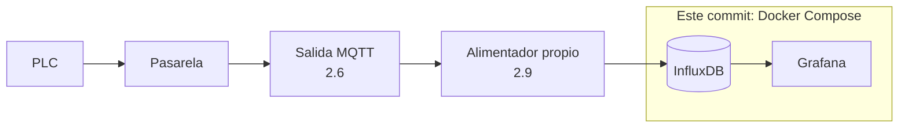

# Monitorización: InfluxDB y Grafana arrancando (tarea 2.10, C0)

**Estado:** los dos servicios arrancan y están conectados. Todavía no hay datos de la planta ni paneles.
Cómo ponerlo en marcha: [`deploy/README.md`](../deploy/README.md).

## Qué hay

| Servicio | Versión | Puerto | Para qué |
|---|---|---|---|
| InfluxDB OSS | 2.7.12 | 8086 | Guarda cada valor con su marca de tiempo |
| Grafana OSS | 12.0.2 | 3000 | Consulta InfluxDB y muestra los paneles |

## Decisiones

| Decisión | Motivo |
|---|---|
| Versión fija de las imágenes | Instalación reproducible (7.2 del enunciado) |
| Contraseñas en `.env`, generadas por `preparar.sh` | Sin secretos en el repositorio |
| Compose se detiene si falta una variable | Evita arrancar con una contraseña vacía |
| Administrador de Grafana distinto de `admin`, sin registro ni acceso anónimo | Requisito de acceso (apartado 6) |
| Fuente de datos provisionada por fichero | El sistema se levanta de cero sin pasos a mano |
| Puertos publicados en `127.0.0.1` por defecto | No exponer los servicios sin decidirlo (se cambia con `IP_PUBLICADA`) |
| `restart: unless-stopped`, comprobación de salud y volúmenes | Recuperación automática sin perder datos |
| Sin Telegraf | Lo prohíbe el enunciado; el alimentador es propio (2.9) |

## Pruebas

Entorno: Ubuntu 24.04 en VirtualBox, Docker 29.1.3 y Compose 2.40.3. 25 de noviembre de 2026.

| Prueba | Resultado |
|---|---|
| `docker compose config` sin `.env` | Se niega: falta `INFLUX_USUARIO` |
| `docker compose up -d` | Los dos servicios `healthy` |
| Salud de la fuente de datos en Grafana | `datasource is working` |
| Escribir un valor en InfluxDB y leerlo a través de Grafana | Leído 42,5 |
| `docker compose down` y `up` | El valor sigue |
| Reiniciar la máquina | Los dos servicios vuelven solos a `healthy` |
| Grafana con `admin`/`admin` | 401 |
| Grafana sin usuario, InfluxDB sin token | 401 |
| `preparar.sh` por segunda vez | No pisa el `.env` existente |
| Permisos de `.env` en Linux | `600` |

El valor de prueba se borró al terminar.

**Error encontrado:** montar `grafana/provisioning` entera tapaba las carpetas que trae la imagen y Grafana
registraba errores al arrancar. Se monta solo `provisioning/datasources`.

## Limitaciones

- Grafana usa el **token de administración** de InfluxDB. Antes de crear el usuario de solo lectura (C7) hay que
  cambiarlo por un token que solo lea.
- El bucket `planta` y la retención de 30 días son provisionales: el esquema se acuerda en el C2.
- Grafana se sirve por HTTP, sin cifrar. Hay que decidirlo antes de publicarlo en la red IT (2.11).
